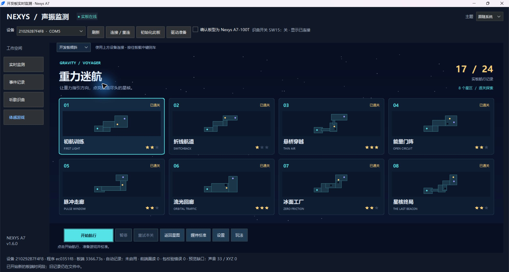

# 基于 FPGA 的多模态智能感知与交互系统

**嵌入式系统课程设计 · Nexys A7-100T · 正式软件 1.6.0**

> **软件下载：[直接下载 Windows EXE](https://github.com/RolandHuang17/nexys-a7-intelligent-sensing/releases/download/v1.6.0/NexysMonitor-v1.6.0-win-x64.exe)**
>
> [设计报告 PDF（28页）](https://github.com/RolandHuang17/nexys-a7-intelligent-sensing/releases/download/v1.6.0/NexysMonitor-v1.6.0-Design-Report.pdf) · [全部发布文件](https://github.com/RolandHuang17/nexys-a7-intelligent-sensing/releases/tag/v1.6.0) · [源码压缩包](https://github.com/RolandHuang17/nexys-a7-intelligent-sensing/releases/download/v1.6.0/NexysMonitor-v1.6.0-source.zip)

无需安装 Python 或 Vivado。EXE 内含运行环境、配套固件和下载后端。适用 **Windows 10/11 x64**，硬件功能需要 **Nexys A7-100T**；无板时可查看界面并用键盘练习游戏。在线识曲需要网络。



## 运行步骤

1. 下载 EXE，开发板接 **PROG/UART** USB 口并上电。软件按实际设备发现，不固定 COM 口。
2. 首次使用或掉电后，确认板型并点“初始化此板”；只加载 SRAM，未导出的板上临时数据会清空。
3. 实时监测页看声音、FFT、XYZ、温度、电压、开关和按键；点“抓取1.5秒”后查看波形、导出和播放。
4. 手机播放歌曲，SW15 拨上或点击进入识曲，等待就绪后连续敲桌 **三下**，相邻间隔约 0.15–1 秒。录音/传输/匹配期间可中止；结果支持历史、收藏及来源查询。
5. SW15 拨下并退出识曲，再进入“体感游戏”。按向导完成校准，轻倾移动，按住 BTNC 中键刹车。键盘练习使用方向键和空格。

首次缺少 USB 驱动时使用软件“驱动准备”引导。已有正常驱动无需重装。原数据保存在 `%LOCALAPPDATA%/NexysMonitor/`。初始化掉电丢失，下次重新加载；不写 Flash。

## 已实现能力

- FPGA 多源采集：2 MHz PDM / 16 kHz PCM、ADXL362 SPI、ADT7420 I²C、XADC、GPIO；统一 100 MHz 时基。
- 声振记录：手动与三类触发策略，前 0.5 秒＋后 1 秒，双组缓存，完整校验后确认释放。
- 智能音频应用：20 秒 8 kHz 完整录音，ShazamIO 在线优先、本地 audfprint 回退，三敲启动和跨阶段中止。
- 数据管理：歌曲导入、历史/次数查询、去重收藏、本地抢歌名。
- 板载反馈：LED/RGB/数码管按真实阶段显示，SW15 进入和退出识曲。
- 体感交互：八关重力迷航、握持/方向校准、中键刹车、失焦暂停、进度保存；与主程序共用唯一 UART 服务。

## 源码运行（Windows / Python 3.12 x64）

```powershell
py -3.12 -m venv .venv
.\.venv\Scripts\python.exe -m pip install -r requirements-locked.txt
.\Get-RuntimeResources.ps1
.\Start-From-Source.ps1
# 无开发板时先查看界面
.\Start-From-Source.ps1 -NoConnect
```

资源恢复脚本下载固定 Release 文件并核对 SHA-256，展开到 `release_assets/`。也可先手动下载运行资源包，然后执行 `Get-RuntimeResources.ps1 -Archive <本地ZIP>`。源码启动使用独立的 `NexysMonitorSource` 用户目录。密封资源清单引用的依赖字节码随资源原样保留；启动脚本禁止重写字节码，以保持资源哈希。

原 `run.ps1`、维护/实验脚本保留为历史研发工具，部分依赖本地 `runs/state` 归档。源码启动使用上述入口；报告数据在 `report/final/data/`，测试记录在 `evidence/`。

## 构建与验证

```powershell
# 在同一固定依赖环境中重新打包；不替换正式 EXE
.\.venv\Scripts\python.exe host/build_shazam_main.py --candidate-only
# 报告：需要完整 TeX Live 与中文字体
.\Build-Report.ps1
# 不打开串口、不发送音频的数字检查
.\.venv\Scripts\python.exe -m unittest discover -s host -p test_game_session.py -v
.\.venv\Scripts\python.exe -m unittest discover -s host -p test_tilt_game.py -v
```

硬件重建使用 Vivado 2026.1，执行 `scripts/build.tcl`，Tcl 参数依次为工程根目录、输出目录、`160000`；目标 `xc7a100tcsg324-1`。例如在已配置 Vivado 的 PowerShell 中：

```powershell
vivado -mode batch -source scripts/build.tcl -tclargs "$PWD" "$PWD/build/fpga" 160000
```

源码、约束、依赖和构建步骤用于功能复现。不同环境重新打包不保证 EXE 字节一致；正式下载文件以发布页 SHA-256 清单为准。

## 版本与测试结果

正式 EXE SHA-256：`23079c2a76c0939dc407192c474db4e7055a56d8937ef376ff8c5c4fa47a4951`。

固件：`ec0351f8`；100 MHz 实现 WNS +0.102 ns、WHS +0.026 ns；BRAM 119.5/135，DSP 9/240。

系统通过 100 项集成检查，实板测试覆盖共享 UART、完整事件导出和配置恢复，EXE 内 158 项资源核对通过。游戏完成八关实板操作测试，三首板载录音的在线识曲回放均匹配成功。测试记录见设计报告及 `evidence/index.json`。

实时预览存在序号缺口，完整数据以通过校验的事件文件为准；传感器尚未进行外部仪表绝对标定。换电脑、第二块板及常规 FTDI 下载路径仍待实板测试。

## 目录与第三方组件

| 目录 | 内容 |
|---|---|
| `rtl/`, `constraints/`, `tests/` | FPGA 电路、约束与 RTL 测试 |
| `host/` | 已验收 1.6.0 的 187 个 Python 文件 |
| `scripts/` | 构建、验证和报告辅助工具 |
| `report/final/` | 最终 LaTeX/TikZ、图片与数据 |
| `evidence/` | 测试记录与完整事件 |
| `publication/` | 版本、资源哈希与源码组成 |

大型运行资源与第三方工具对应源码在 Release，许可及署名见 [THIRD_PARTY_NOTICES.md](THIRD_PARTY_NOTICES.md)。商业歌曲完整原曲、个人数据库与凭据不进入公开包。公开可见不自动授予自研文件新的统一开源许可证；第三方组件沿用原许可证。
